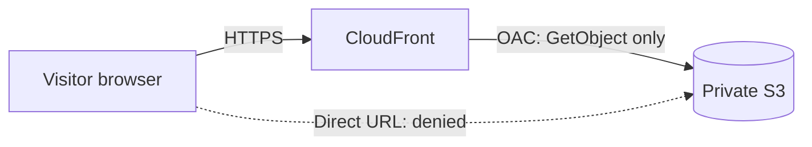

# Terraform: Secure Static Website (S3 + CloudFront)

My full static website on AWS, written as **Infrastructure as Code** with Terraform. One command builds a private S3 bucket, a CloudFront distribution, and the permissions that connect them. One command removes everything.

This is the code version of a site I first built by hand in the AWS console. See my companion projects: **aws-s3-cloudfront-static-site** (manual build) and **terraform-private-s3-bucket** (my first Terraform bucket).

## What it creates

| Resource | Purpose |
|---|---|
| `aws_s3_bucket` | Private bucket named `fran-terraform-site-2026` |
| `aws_s3_bucket_public_access_block` | Block all public access |
| `aws_s3_object` | Uploads `index.html` to the bucket |
| `aws_cloudfront_origin_access_control` | Lets only CloudFront read the private bucket (OAC) |
| `aws_cloudfront_distribution` | Serves the page over HTTPS, with `index.html` as the default root object |
| `aws_s3_bucket_policy` | Allows `s3:GetObject` only from this distribution (`AWS:SourceArn` condition) |

An output (`site_url`) prints the CloudFront address after the build.

## Architecture



## Files

| File | Purpose |
|---|---|
| `main.tf` | All resources |
| `outputs.tf` | Prints the site URL |
| `index.html` | The web page |
| `.terraform.lock.hcl` | Locks the AWS provider version |

The state files (`terraform.tfstate`, `terraform.tfstate.backup`) and the `.terraform` folder are intentionally **not** in this repository, because state can contain sensitive details and the plugin folder is large.

## How to run it

I used **AWS CloudShell**, which signs in with my console session, so no access keys were needed.

```bash
terraform init      # download the AWS provider
terraform validate  # check the code
terraform plan      # preview the changes (creates nothing)
terraform apply     # build it after typing "yes"
```

Bucket names are globally unique, so change the bucket name in `main.tf` if it is already taken.

## Results

- `terraform plan` showed **6 to add, 0 to change, 0 to destroy**.
- `terraform apply` created the resources, and the CloudFront distribution took a few minutes.
- The page loaded over HTTPS at the CloudFront address.
- The direct S3 address returned `AccessDenied`, and Block all public access was **On**.
- CloudTrail Event history showed the `CreateDistributionWithTags` event for the build.

## Clean up

```bash
terraform destroy   # removes all 6 resources
```

The destroy finished with **6 destroyed**. Deleting a CloudFront distribution took about 3 minutes.

## Challenges and lessons learned

- **Wrong cache policy ID.** The first `apply` failed with `NoSuchCachePolicy` because one character was wrong in the managed cache policy ID. I checked the ID against the AWS documentation, fixed it, and ran `apply` again. Terraform continued from where it stopped.
- **No space left on device.** A second project folder could not install the AWS provider, because CloudShell's permanent storage is limited and each project keeps its own copy of the plugin (about 760 MB). I found the cause with `df` and `du`, deleted the old `.terraform` folder, and ran `terraform init` again.
- **CloudShell resets.** The Terraform program can disappear after a session resets, while files in the home folder stay. I reinstalled it from HashiCorp's repository.
- **Read the plan first.** Checking the resource names, Region, and summary line before typing `yes` is a habit I now follow every time.

## Next steps

- [ ] Look up the cache policy by name with a Terraform data source, so no ID is typed by hand
- [ ] Add a GitHub Actions workflow to check the code automatically
- [ ] Practice remote state storage

---

*Built by Fran. README drafted with help from Claude.*
